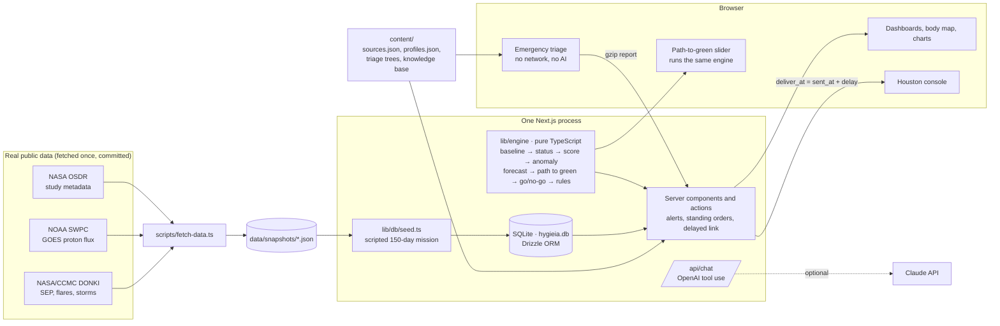

# Hygieia

An onboard crew-health assistant for deep-space missions, where the flight surgeon is up to 22 minutes away each way. Named after **Hygieia, the Greek goddess of health**.

Built for the NASA Space Apps 2026 challenge *Create Health Monitoring Software for Astronauts on Space Missions* (challenge author: Brazilian Space Agency) by team **Jovian Elites**.

Hygieia learns each astronaut's personal baseline, says in plain words when they drift from it and why, proposes the smallest change that brings them back to green, checks who is fit for upcoming tasks, and guides the crew through a medical emergency without waiting for Earth. It adapts to a transit spacecraft, a space station, a lunar base and a Mars surface base, and uses real public space-agency data for radiation and space weather.

> **This is a demo on one laptop. Crew data is synthetic. Hygieia is not medically validated.**

## Run it

Needs Node 22 or newer.

```bash
npm install
npm run fetch-data   # optional: refresh the real-data snapshots (needs the internet)
npm run seed
npm run dev
```

Or in one step, seeded on Day 143 and opened in the browser:

```bash
npm run demo
```

The demo runs with the network off. Ask Hygieia uses the OpenAI API: copy `.env.example` to `.env.local` and set `OPENAI_API_KEY`. Without it, the chat panel explains that the key is missing; everything else works.

Tests:

```bash
npm test             # Vitest: engine, data adapters and the scripted storyline
npm run test:e2e     # production build + Playwright walk through storyline steps 1–8
```

Record the demo video (1 minute 50 seconds, 1080p): three intro cards (the name, the challenge, the team), the walkthrough with captions, and a thank-you card.

```bash
npm run build
```

```bash
npm run demo -- --prod --no-open
```

Then, in a second terminal:

```bash
npm run demo:video
```

It drives one crew member's dashboard with Playwright, then uses ffmpeg to add the cards and captions, and writes `demo.mp4`. Scenes and captions are in `scripts/demo-video.ts`; card lengths, team names and the challenge title are in `scripts/demo-timing.ts`. The first time, run `npx playwright install chromium ffmpeg`.

Add a spoken narration and write `demo-voiced.mp4`. By default it uses a natural-sounding Microsoft neural voice, which needs the internet and sends the narration text to Microsoft's speech service:

```bash
npm run demo:voice
```

The narration lines are in `scripts/demo-voiceover.ts`. Other voices: `npm run demo:voice -- --voice en-US-AndrewMultilingualNeural`. Fully offline, with the built-in Windows voice: `npm run demo:voice -- --offline`. To use your own recording instead, save it as `voiceover.m4a` and run:

```bash
node_modules/ffmpeg-static/ffmpeg.exe -y -i demo.mp4 -i voiceover.m4a -map 0:v -map 1:a -c:v copy -c:a aac -b:a 192k -af "loudnorm=I=-16:TP=-1.5,apad" -t 110 demo-voiced.mp4
```

## The demo storyline

1. **Crew dashboard, Day 143.** Three crew are green. Haddad is red: sleep has been down for several nights; mood and heart-rate variability followed.
2. **Haddad's dashboard.** Head red, heart amber. "Smallest path back to green: sleep 7 h for 2 nights + 1 h shared crew time. Projected green by Day 146."
3. **Readiness.** "Day 145 spacewalk: not ready. Suggested swap: Sato (green, EVA-trained)."
4. **Slider.** Drag "sleep tonight" and the projected recovery day moves. It runs in the browser.
5. **Standing order.** It fired after two short nights. The advice carries the flight surgeon's name and needed no round trip to Earth.
6. **Space weather.** A real solar particle event (5 September 2026, NASA/CCMC DONKI) is replayed on Day 120 and shows in the dose chart with its source link.
7. **Emergency.** Chest pain by voice or buttons → vital signs → CPR metronome at 110 per minute → the log is gzip-compressed and shown in transit to Earth.
8. **Profile toggle.** Transit → Mars surface base: the kit, thresholds, dose rate and a triage step change.

## Architecture



- **App:** Next.js (App Router), React, TypeScript, one process. Tailwind CSS with components in the shadcn/ui pattern. Recharts for charts. The body map is an inline SVG component.
- **Database:** SQLite through better-sqlite3 and Drizzle ORM, one file, rebuilt from the seed.
- **Engine:** `lib/engine` is pure TypeScript with no Node or DOM imports, so the same code runs on the server and in the browser. `ml-matrix` does the linear algebra for the whole-body anomaly check.
- **Triage:** JSON trees bundled with the app. Voice through the Web Speech API, the CPR metronome through the Web Audio API, and report compression through the browser's `CompressionStream('gzip')`.
- **Delayed link:** every message between ship and Earth is stored with `deliver_at = sent_at + delay`.
- **AI chat:** the OpenAI Responses API with tool use. Set `OPENAI_API_KEY`; defaults are `OPENAI_MODEL=gpt-6-luna` and `OPENAI_REASONING_EFFORT=none`. The API receives the chat, mission context, and data returned by the tools the astronaut is allowed to use.

More detail: [how the algorithms work](docs/algorithms.md) · [how each dataset is used](docs/datasets.md) · [deploying](docs/deploy.md).

Useful entry points: `lib/engine/index.ts`, `lib/db/seed.ts`, `lib/server/alerts.ts`, `content/profiles.json`, `content/triage/chest_pain.json`, `content/sources.json`.

## Screens

| Route | Content |
|---|---|
| `/` | Crew dashboard: roster, go/no-go, space weather, alerts, cabin, team goals, link |
| `/astronaut/[id]` | Individual dashboard with body map, charts, path back to green, radiation |
| `/astronaut/[id]/check` | Daily log, mood, reaction test, vision check, private journal |
| `/triage` | Emergency mode, also from the red button on every page |
| `/houston` | Shared data, standing orders, inbox |
| `/space-weather` | Real events, S-level, dose impact, storm-shelter checklist |
| `/kb` | Knowledge base: one note per NASA HRP risk |
| `/sources` | Data provenance and credits |
| `/about` | Hygieia, the team, hazards and risks coverage, disclaimer |

## Data sources and credits

Every sourced number on screen links to its entry on `/sources`. The interface does not label the remaining values; they are listed under "Honesty notes" below and in `docs/datasets.md`.

| Source | Used for | Credit |
|---|---|---|
| DONKI space-weather database | Real solar particle events and flares, replayed on the mission clock | NASA/CCMC DONKI |
| GOES integral proton flux, NOAA S-scale | Current S-level (S1 starts at 10 pfu of ≥10 MeV protons) | NOAA SWPC (U.S. public domain) |
| MSL RAD cruise measurements (Zeitlin et al., *Science* 2013) | Transit dose rate, 1.8 mSv/day | NASA/JPL-Caltech/SwRI |
| MSL RAD in Gale Crater (Hassler et al., *Science* 2014) | Mars surface dose rate, 0.67 mSv/day | NASA/JPL-Caltech/SwRI |
| Chang'E 4 LND (Zhang et al., *Science Advances* 2020) | Lunar surface dose rate, 1.369 mSv/day | CNSA / Kiel University / DLR |
| DOSIS and DOSIS 3D in Columbus (Berger et al., 2017) | Station dose rate: 0.575 mSv/day, a midpoint between this paper's 0.647 peak and the ~0.53 implied by the Chang'E 4 paper | ESA / DLR, ESA HREDA |
| "Monitoring radiation for astronaut health" (2026) | Neutron channel, about 30% of the total on the ISS | CSA |
| OSDR Biological Data API | Study records for the "Evidence in NASA OSDR" links | NASA OSDR |
| HRP hazards, risks and ongoing research pages | The five hazards, the 17 risks, and the studies the simulated sensors are modelled on | NASA Human Research Program |
| NASA-STD-3001 CO₂ technical brief | Cabin CO₂ amber line, 3 mmHg one-hour average | NASA OCHMO |
| JPL Horizons ephemeris | Real Earth–Mars and Earth–Moon light time for each mission day; confirms the 22-minute worst case | NASA/JPL Horizons |
| Planetary K index | Geomagnetic activity on the Space Weather page | NOAA SWPC |
| POWER surface weather | Earth mode: outdoor heat index at the demo clinic site | NASA Langley POWER Project |
| Heat-index equation and categories | Earth mode: heat index and its alert levels | NOAA NWS |
| Natural background dose, 2.4 mSv/year | Earth mode dose rate | UNSCEAR |

Linked but not downloaded: NASA OSDR RadLab, NASA OSDR EDA, ESA HREDA, JAXA PADLES and SEDA-AP, DLR MARE, INPE EMBRACE, the CSA open data portal. The full list with URLs is in `content/sources.json`, and [docs/datasets.md](docs/datasets.md) explains how each one is used.

## Honesty notes

- Crew data is synthetic. Environment data is real where stated. Hygieia is not medically validated.
- The recovery response coefficients and most clinical thresholds are demo values.
- Bone loss is inferred from exercise adherence. It is not measured.
- The AI chat uses a cloud API a Mars crew would not have; it stands in for a future onboard model. Triage, alerts, standing orders and scoring never depend on it.
- The 22-minute delay is the worst-case one-way Earth–Mars light time; the demo compresses it to 20 seconds.
- A real solar particle event sets the timing of the replayed storm. The size of the dose spike on board is a demo value.
- Voice commands use the browser's speech recognition, which in Chrome and Edge needs a network. Buttons, typed commands and read-aloud prompts work offline.
- The triage trees are demo protocols. A flight surgeon would have to approve real ones.

## Built with

Hackathon offers and how Hygieia uses each:

- **Google Cloud** — the app is packaged as a container for Cloud Run (`Dockerfile`, `docs/deploy.md`). The database is rebuilt from the seed on every cold start, which is intended for a demo.
- **GoDaddy** — a domain pointed at the hosted demo by CNAME, and the included hosting for the static project page.
- **Microsoft** — GitHub Copilot and Teams for the team; an optional mirror on Azure App Service.
- **Miro** — architecture and storyline boards for the pitch.
- **Meteomatics** — not used. Earth mode gets its outdoor heat data from NASA POWER instead, which is free and needs no account.

Not yet deployed: see the status note at the top of `docs/deploy.md`.

## Earth mode

Select the **Remote clinic** profile. The same engine and triage run for a rural health post: clinic kit, standard chest compressions, background radiation, a store-and-forward link to a remote doctor, and an outdoor heat card built from real NASA POWER weather. The header has a language toggle (English, French, Arabic with right-to-left layout). It translates the navigation, header and dashboard headings; alerts, advice and triage steps stay in English until a clinician has reviewed a translation.

## Not built

- The Firebase relay for running Houston on a second device. Houston runs in the same app at `/houston`.
- Sign-in, encryption, real device integration and regulatory compliance are out of scope.

## Team

Jovian Elites: Joelle El Homsi, Elie Chalhoub, Rahma Bezzaouia, Ahmad Abu Zainab.
